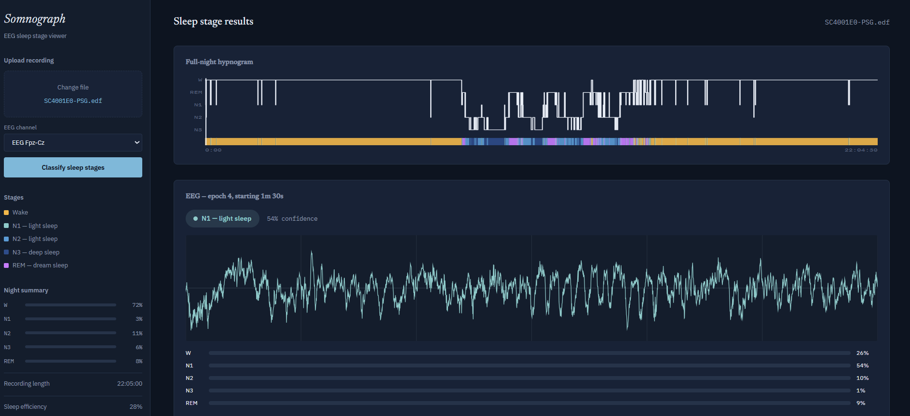

# Somnograph — Sleep Stage Inference Service + Viewer

A FastAPI inference service and a React web app for the sleep-stage model
trained in [EEG-based-sleep-stage-classification](https://github.com/neural-bit/EEG-based-sleep-stage-classification): upload a raw PSG EEG recording (.edf), and the app
classifies every 30-second epoch into a sleep stage (Wake, N1, N2, N3, REM)
and shows a full-night hypnogram plus the raw EEG waveform for whichever
epoch you're looking at.



*Full-night hypnogram visualization paired with continuous raw EEG epoch inspection.*


```
                    ┌───────────────────────────┐
   .edf upload ───► │   FastAPI inference API   │
                    │   MNE preprocessing       │
                    │   1D CNN / CNN-LSTM model │
                    └─────────────┬─────────────┘
                                  │ JSON: per-epoch stage + probabilities
                                  ▼
                    ┌───────────────────────────┐
                    │   React web app           │
                    │   Hypnogram (SVG)         │
                    │   EEG waveform (canvas)   │
                    │   Epoch navigator         │
                    └───────────────────────────┘
```

The backend is stateless per request except for one thing: raw per-epoch
waveforms are kept in a short-lived in-memory session (keyed by a
`session_id` returned from `/api/predict`) so the frontend can fetch one
epoch's full-resolution waveform on demand instead of the initial response
having to embed every sample of every epoch in the recording.

## Project layout

```
somnograph-inference-app/
├── backend/
│   ├── app/
│   │   ├── main.py            # FastAPI app + routes
│   │   ├── config.py          # env-driven settings
│   │   ├── model_arch.py      # CNN / CNN-LSTM
│   │   ├── model_loader.py    # loads the checkpoint at startup
│   │   ├── preprocessing.py   # EDF -> 30s epochs
│   │   ├── inference.py       # batched forward pass -> stage + probabilities
│   │   ├── session_store.py   # in-memory store for on-demand waveform fetch
│   │   └── schemas.py         # Pydantic request/response models
│   ├── models/README.md       # where to drop your trained checkpoint
│   ├── requirements.txt
│   ├── Dockerfile
│   └── .env.example
├── frontend/
│   ├── src/
│   │   ├── App.jsx
│   │   ├── api.js             # fetch wrapper for the backend
│   │   ├── utils/stages.js    # shared stage colors/labels
│   │   └── components/
│   │       ├── FileUpload.jsx
│   │       ├── StageLegend.jsx
│   │       ├── SummaryStats.jsx
│   │       ├── Hypnogram.jsx      # full-night step chart + color ribbon
│   │       ├── EEGViewer.jsx      # canvas waveform + stage badge + probabilities
│   │       ├── EpochControls.jsx  # prev/next/play
│   │       └── Sidebar.jsx
│   ├── styles/{index.css, App.css}
│   ├── Dockerfile, nginx.conf
│   └── .env.example
├── docker-compose.yml
└── README.md
```

## API

| Method | Path | Purpose |
|---|---|---|
| GET | `/api/health` | liveness check |
| GET | `/api/model/info` | model name, device, whether a checkpoint is loaded |
| POST | `/api/predict?channel=EEG+Fpz-Cz` | multipart-upload a `.edf`, get per-epoch predictions + a `session_id` |
| GET | `/api/waveform/{session_id}/{epoch_index}` | full-resolution samples for one epoch |

`POST /api/predict` response (abridged):

```json
{
  "session_id": "a1b2c3...",
  "filename": "SC4001E0-PSG.edf",
  "channel": "EEG Fpz-Cz",
  "sfreq": 100.0,
  "n_epochs": 942,
  "stage_counts": {"W": 180, "N1": 62, "N2": 410, "N3": 140, "REM": 150},
  "epochs": [
    {"index": 0, "start_time_sec": 0, "stage_name": "W", "stage_index": 0,
     "probabilities": {"W": 0.91, "N1": 0.04, "N2": 0.03, "N3": 0.01, "REM": 0.01}}
  ]
}
```

Interactive docs are available at `http://localhost:8000/docs` once the
backend is running (FastAPI's built-in Swagger UI).

## Running it

### 1. Get a trained checkpoint

Drop `best_model.pt` from [EEG-based-sleep-stage-classification](https://github.com/neural-bit/EEG-based-sleep-stage-classification) into `backend/models/`. 

### 2. Backend

```bash
cd backend
python -m venv venv && source venv/bin/activate
pip install -r requirements.txt
cp .env.example .env      # adjust if your checkpoint uses non-default settings
uvicorn app.main:app --reload --port 8000
```

### 3. Frontend

```bash
cd frontend
npm install
cp .env.example .env.local
npm run dev      # http://localhost:5173
```

### Or both at once with Docker

```bash
docker compose up --build
# frontend: http://localhost:8080
# backend:  http://localhost:8000/docs
```

